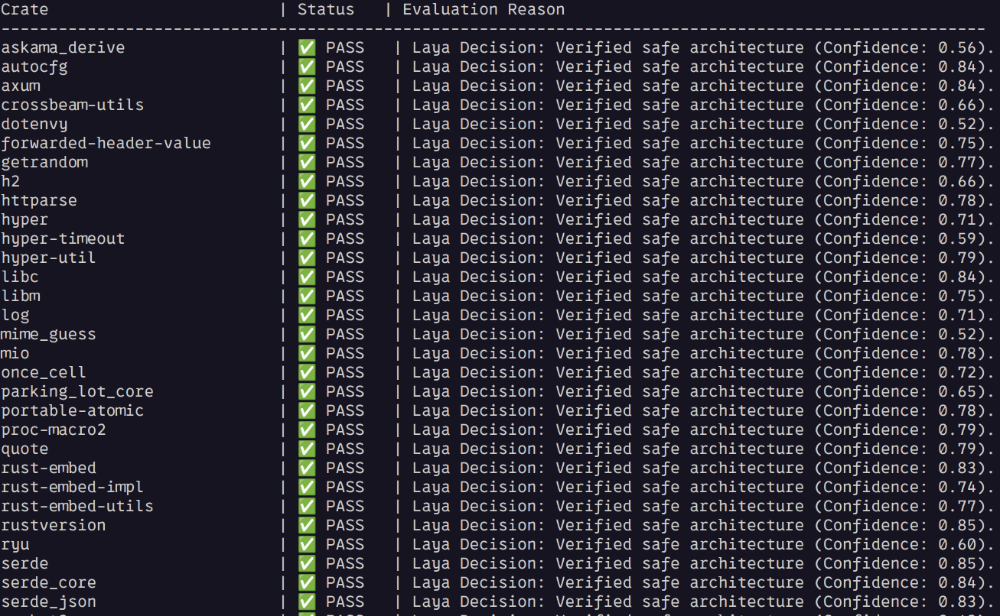

# Rust Crates Security Auditor (Laya Testbed)

An experimental Rust crate auditor combining laya (System 1 heuristics) with local decision models.



> ⚠️ **Disclaimer**: This project is **not** intended to replace production tools like `cargo-vet`. Its primary purpose is to serve as an experimental testbed for evaluating the **Laya** decision model (`convaiinnovations/laya`) in reducing false positives typically found in static security heuristics (such as flagging `std::env` or `std::process` usage across dependencies).

---

## Prerequisites & Dependencies

* **Operating System**: Linux (Ubuntu, Debian, Fedora, etc.) not tested in **WSL**.
* **Python**: Version **3.10** or higher.
* **Rust / Cargo**: Installed and available in your `$PATH` (required to read project metadata).

### Python Dependencies (`requirements.txt`)
* `laya` (Official Laya decision package)
* `torch` (PyTorch backend for tensor operations)
* `transformers` (Hugging Face model management)
* `huggingface-hub` (Model downloading and hub integration)

---

## Installation

### Option 1: Automated Installation (Recommended)
You can set up the project locally and link it as a global command using the provided installation script:

```bash
# Clone or navigate to your project directory
cd audit-rust-crates-laya

# Run the installation script
bash install-laya.sh

```

This script will:

1. Verify if your Python version is compatible (3.10+).
2. Create an isolated Python virtual environment (`venv`).
3. Install all required packages from `requirements.txt`.
4. Create a global wrapper command (`audit-rust-crates-laya`) inside `~/bin`.

> **Note**: Ensure that `~/bin` is included in your system's `$PATH` (e.g., exported in your `~/.bashrc` or `~/.zshrc`).

### Option 2: Manual Installation

If you prefer setting it up manually:

```bash
# 1. Create and activate virtual environment
python3 -m venv venv
source venv/bin/activate

# 2. Upgrade pip and install dependencies
pip install --upgrade pip
pip install -r requirements.txt

```

---

## Usage

Run the auditor from the root directory of any valid Rust project (where `Cargo.toml` is located):

### 1. Run with Laya Decision Model (Default)

```bash
audit-rust-crates-laya --model-path convaiinnovations/laya

```

### 2. Run with Optional Download Metrics from crates.io

```bash
audit-rust-crates-laya --fetch-downloads

```

### 3. Fallback to Deterministic TOML Policy Mode

If you prefer strict policy-based checking without AI inference:

```bash
audit-rust-crates-laya --model-path policy.toml

```

---

## Project Structure

* `audit-rust-crates-laya.py`: Core logic handling Cargo metadata extraction, heuristic scanning, and Laya decision queries.
* `install-laya.sh`: Environment provisioning, dependency installer, and global binary setup script.
* `requirements.txt`: Pinned Python package dependencies.
* `policy.toml`: Fallback local capability policy template.

```
